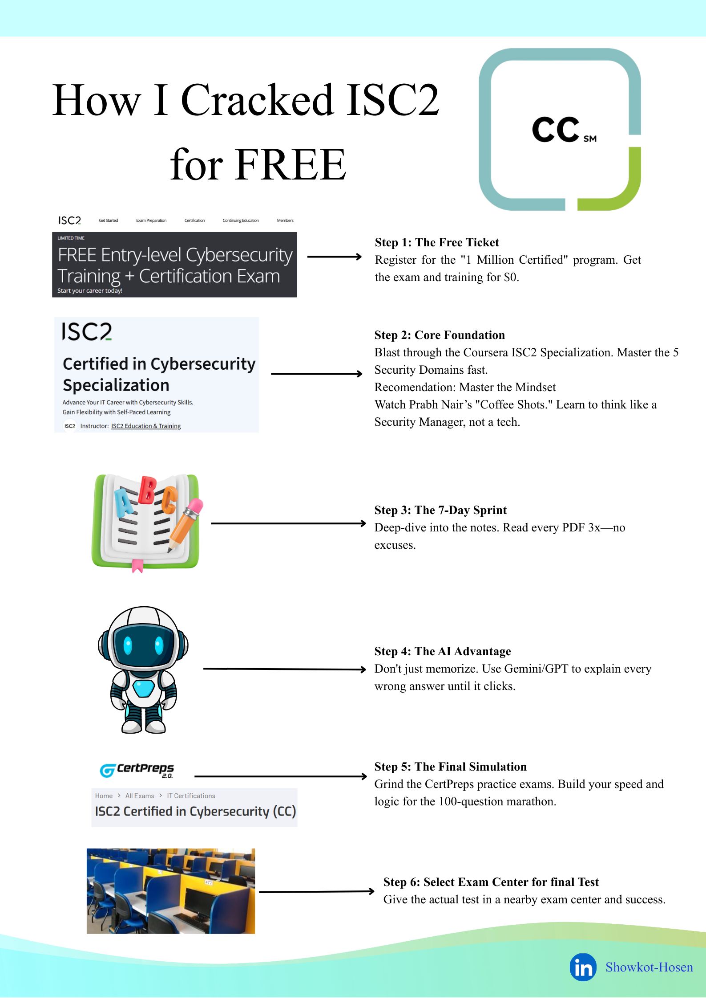

# ISC2 Certified in Cybersecurity (CC) - Preparation Roadmap 🚀

This repository contains the roadmap, resources, and strategy I used to prepare for the exam, specifically tailored for beginners.

## 📌 Step 1: Registration
ISC2 closed new enrolments in its free "One Million Certified in Cybersecurity" program on 20 May 2026. If you already have an unexpired exam code from the program, ISC2 says you must use it to schedule and take the exam by 31 December 2026.
- [ISC2 program page](https://www.isc2.org/landing/1mcc)

## 📌 Step 2: Core Learning
I started with the formal training to understand the 5 Domains:
1. Security Principles
2. Business Continuity (BC), Disaster Recovery (DR) & Incident Response Concepts
3. Access Controls Concepts
4. Network Security
5. Security Operations

**Primary Resource:** [Coursera ISC2 CC Specialization](https://www.coursera.org/specializations/certified-in-cybersecurity)

## 📌 Step 3: Intensive Revision (7-Day Sprint)
This is where I solidified my knowledge. I used the following:
- **Main Resource:** Cyberfascinate GitHub Material
- **Strategy:** I read the PDFs **3 times** to ensure the concepts were etched in my mind.
- **AI Integration:** For every practice question I got wrong, I asked Gemini/GPT to explain the "Why" behind the correct answer. Understanding the logic is key!

## 📌 Step 4: Community Recommendations (Highly Rated)
While I focused on the resources above, many successful candidates highly recommend **Prabh Nair**. His "Coffee Shots" and domain reviews are legendary for developing the "Managerial Mindset" needed for ISC2 exams.
- **Video Resource:** [Prabh Nair's ISC2 CC Playlist (YouTube)](https://youtube.com/playlist?list=PL0hT6hgexlYw-k6GxQf_DIAPdc96T2MP-&si=D8H0Q26KCLocwKgD)

## 📌 Step 5: Final Practice Tests
Before the real deal, I tested my speed and logic here:
- [CertPreps Practice Exams](https://certpreps.com/exams/cc/?register=success)
- [ExamCrest CC Sample Questions](https://examcrest.com/exam/isc2-cc/free-questions?utm_source=github&utm_campaign=showkot-cc) (free, no signup; full mock tests are paid)

## 📝 Exam Day Tips (Dhaka Center Experience)
- **Location:** Mentors', Dhanmondi, Dhaka.
- **Strict Environment:** No phones, wallets, or electronics allowed in the testing room.
- **Communication:** Strict "No Voice" policy. Use hand gestures to get the proctor's attention.
- **The Questions:** 100 total. **Warning:** Do not expect them to be exactly like practice tests. They test your **conceptual understanding** and ability to apply the CIA Triad to real-world scenarios.

## 🤝 Connect with Me
If you have questions about the process or the exam experience, feel free to reach out!
- **LinkedIn:** [Showkot Hosen](https://www.linkedin.com/in/showkot-hosen10/)
- Share with friends and Give Star if you like it.
